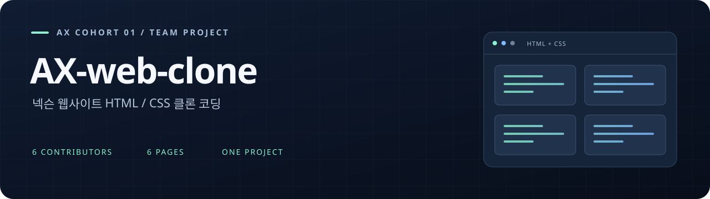
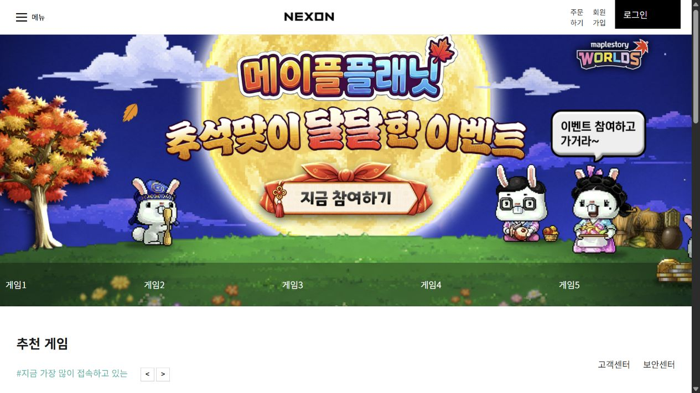
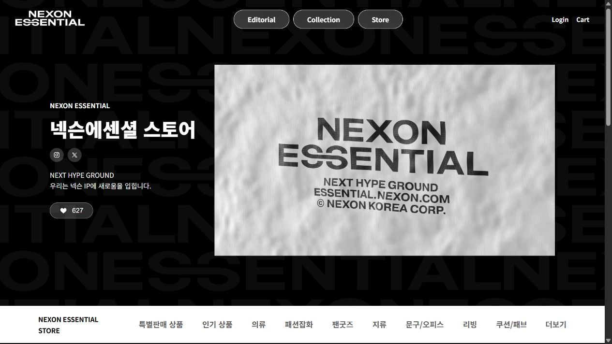
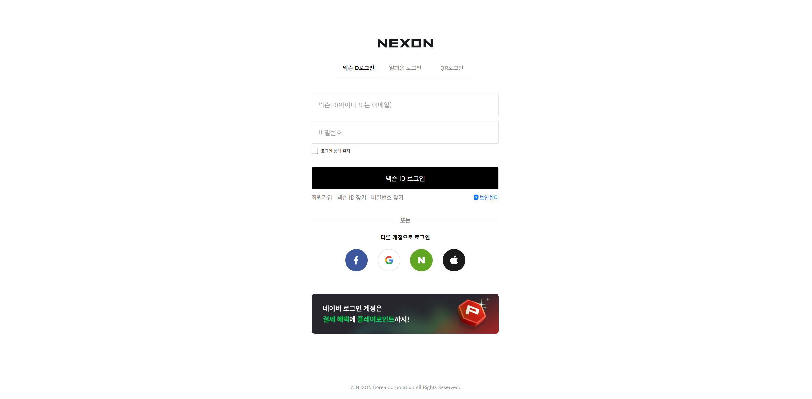
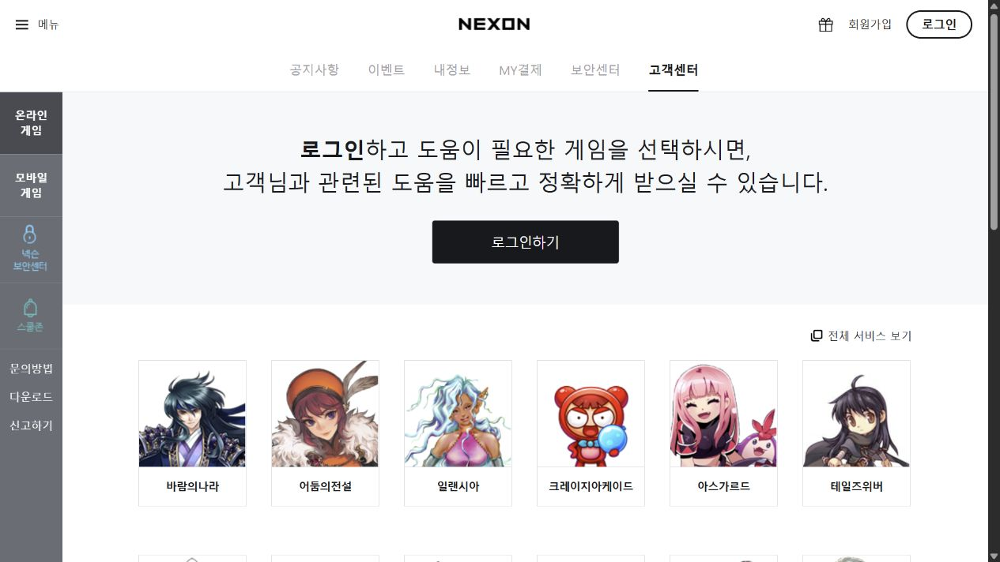
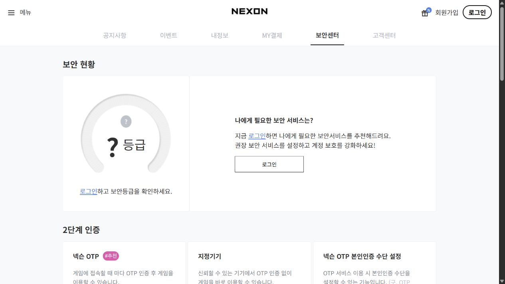
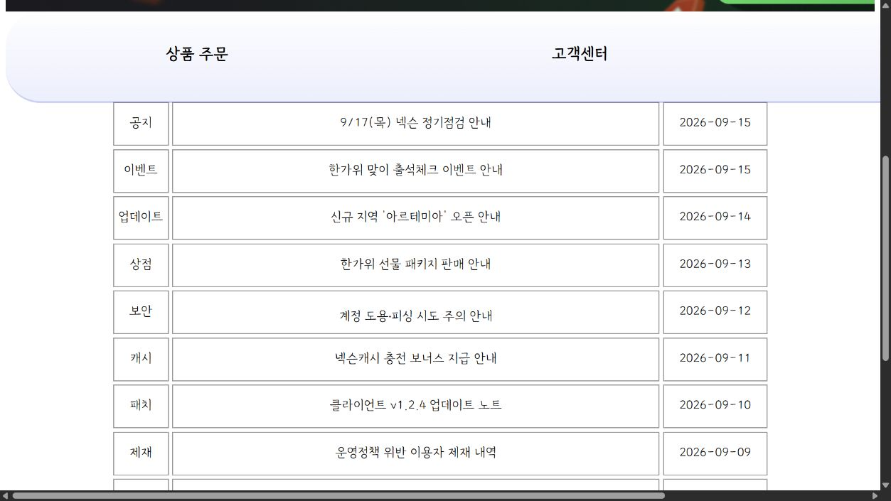

<p align="center">
  
</p>

<p align="center">
  
  
  
  
</p>

<p align="center">
  <b>여섯 명의 페이지를 하나의 웹 프로젝트로.</b><br>
  넥슨 웹사이트의 화면을 나누어 구현한 HTML/CSS 팀 프로젝트
</p>

<p align="center">
  <a href="#화면-미리보기">화면 미리보기</a> / <a href="#팀원과-역할-분담">팀 소개</a> / <a href="#협업-과정">협업 과정</a> / <a href="#개인별-구현과-회고">개인별 구현과 회고</a> / <a href="#실행-방법">실행 방법</a>
</p>

## 프로젝트 소개

AX 1기 팀원 6명이 넥슨 웹사이트의 주요 화면을 나누어 HTML과 CSS로 구현한 학습 프로젝트입니다. 로그인, 메인, 상품 목록, 고객센터, 보안센터, 공지사항을 각각 제작하고, GitHub의 작업 브랜치와 Pull Request를 통해 하나의 저장소로 통합했습니다.

각 페이지의 레이아웃, 여백, 글꼴, 색상과 UI 요소를 구성하며 HTML/CSS를 연습했습니다. 구현 범위는 정적인 화면과 페이지 연결이며, 실제 로그인 인증, 주문 처리, 결제나 데이터 저장은 포함하지 않습니다.

넥슨 웹사이트 클론코딩 팀 프로젝트(6인) 중 **로그인 페이지**를 담당해 구현했습니다.

| 구성 | 내용 |
| --- | --- |
| 참여 | AX 1기, 6인 팀 |
| 구현 | HTML5, CSS3로 제작한 6개 페이지와 시작 화면 |
| 협업 | Git, GitHub, 페이지별 작업 브랜치, Pull Request |
| 시작점 | [index.html](index.html)에서 모든 페이지로 이동 |

## 화면 미리보기

로컬 리소스를 포함한 실행 환경에서 캡처한 실제 구현 화면입니다. 이미지를 누르면 크게 볼 수 있습니다.

<table>
  <tr>
    <td width="50%"><a href="docs/readme/02-main.png"></a><br><b>02 / 메인</b> — 장예지<br>대표 배너, 게임 카드, 페이지 연결</td>
    <td width="50%"><a href="docs/readme/03-store.png"></a><br><b>03 / 상품 목록</b> — 김민지<br>스토어 소개, 영상, 상품 카드</td>
  </tr>
  <tr>
    <td><a href="docs/readme/01-login.png"></a><br><b>01 / 로그인</b> — 원정린<br>로그인 유형 선택, 입력 폼, 소셜 버튼</td>
    <td><a href="docs/readme/04-support.png"></a><br><b>04 / 고객센터</b> — 양석호<br>사이드바, 로그인 안내, 게임별 문의 카드</td>
  </tr>
  <tr>
    <td><a href="docs/readme/05-security.png"></a><br><b>05 / 보안센터</b> — 이승주<br>보안 현황, 2단계 인증, 서비스 안내</td>
    <td><a href="docs/readme/06-notice.png"></a><br><b>06 / 공지사항</b> — 배경일<br>카테고리 메뉴, 공지 목록, Grid 배치</td>
  </tr>
</table>

캡처 시점에 로그인 로고가 표시되지 않고, 일부 화면에 가로 넘침과 임시 콘텐츠가 남아 있습니다. 화면 미리보기는 이러한 현재 상태를 포함합니다.

## 2. 구현 화면

로그인 폼(메인)부터 하단 푸터까지의 전체 화면입니다. 로그인 페이지에는 별도 헤더가 없어 상단 로고 영역이 화면 맨 위에 위치합니다.


## 3. 개인 구현 내용

### HTML 마크업
- `main` / `section` / `footer`로 페이지 구조를 나눴습니다.
- 로그인 유형(넥슨ID / 일회용 / QR)은 `radio`와 `label for`를 연결했습니다.
- 이메일·비밀번호 입력란에 `type="email"`, `type="password"`, `required`를 적용했고, 로그인 상태 유지 체크박스는 `label`과 연결했습니다.
- 소셜 로그인 아이콘에 `alt`를 넣었습니다.

### CSS 스타일링
- 박스 모델: `box-sizing: border-box`, `margin` / `padding`으로 간격을 구성했습니다.
- Flexbox: 계정 찾기 링크와 소셜 로그인 아이콘을 가로로 배치했습니다.
- 상태 표현: 라디오 선택 시 글자색과 밑줄 변경, 입력창 `:focus` 테두리, 버튼 `:hover`를 적용했습니다.
- 가상 요소: "또는" 양옆 구분선을 만들었습니다.
- `:root` 변수로 최대·최소 너비, 글꼴 크기와 색을 관리했습니다.

## 4. 트러블슈팅

| 문제 | 원인 | 해결 |
| --- | --- | --- |
| 로고와 아이콘이 표시되지 않음 | 이미지 폴더가 `.gitignore`로 제외되어 저장소에 없었고, 상대경로도 맞지 않았음 | 이미지를 `html/images/01_login/`에 넣고 HTML 경로를 `images/01_login/...`으로 수정 |

## 5. 회고

### 좋았던 점
브랜치와 PR을 활용한 Git/GitHub 협업을 제대로 경험하며 Git 이해도를 크게 높였습니다.

### 아쉬웠던 점
- 구조를 꼼꼼히 잡지 않고 시작해서 CSS `:root`를 충분히 활용하지 못했고, 중복 코드가 많았습니다.
- 중간 점검 없이 각자 작업한 뒤 마지막에 합쳐서, 이미지 경로 문제를 뒤늦게 발견했습니다.
- 개인 사정으로 최종 시연과 발표에 참여하지 못했습니다.

### 배운 점과 다짐
구현 속도보다 구조 설계가 먼저라는 것, `:root`로 공통 스타일을 먼저 잡는 것의 중요성을 배웠습니다.
팀 작업은 마지막에 합치기보다 중간 점검이 필요하다고 느꼈습니다.

## 6. 실행 방법

```bash
git clone https://github.com/justinweon/Ch02_FE_CloneCoding_practice.git
```

`html/01_login.html`을 브라우저로 엽니다. (VS Code Live Server 권장, 설치·빌드 불필요)


## 폴더 구조

```text
AX-web-clone/
├─ html/
│  ├─ 00_common_.html         # 공용 HTML 초기 파일
│  ├─ 01_login.html          # 로그인
│  ├─ 02_main_page.html      # 메인
│  ├─ 03_order_page.html     # 상품 목록
│  ├─ 04_customer_service.html
│  ├─ 05_security_centre.html
│  ├─ 06_notice.html
│  └─ images/               # 저장소에 포함된 메인 페이지 이미지
├─ css/                     # 페이지별 스타일, 시작 화면 스타일
├─ docs/
│  ├─ readme/               # 프로젝트 배너와 실제 화면 캡처
│  └─ retrospectives/       # 팀원별 구현 소개와 개인 회고
├─ index.html               # 6개 페이지로 이동하는 시작 화면
├─ .gitignore
└─ README.md
```

페이지별 HTML과 CSS는 같은 번호와 이름으로 대응합니다. `00_common_` 파일은 현재 내용이 없는 초기 파일이며, 각 페이지의 스타일은 개별 CSS에 작성되어 있습니다.
