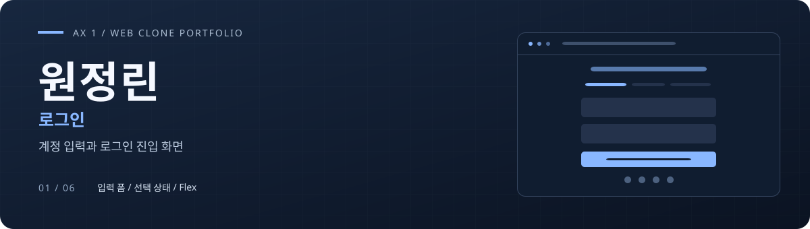
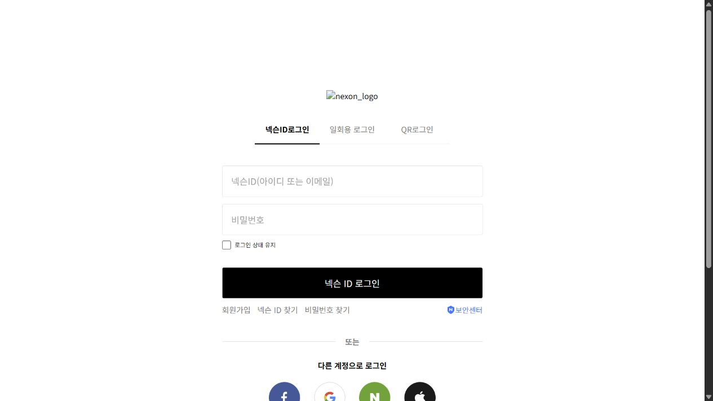

  

  <a href="../../README.md">프로젝트</a> / <a href="../../html/01_login.html">HTML</a> / <a href="../../css/01_login.css">CSS</a> / <a href="https://github.com/justinweon">GitHub</a>

<b>넥슨ID 입력 폼을 중심으로 로그인 유형, 계정 찾기, 소셜 로그인 버튼을 배치한 화면입니다.</b>

AX 1기 팀 프로젝트 / 로그인 / HTML5 / CSS3

[화면 미리보기](#화면-미리보기) / [구현한 내용](#구현한-내용) / [회고](#회고)

## 화면 미리보기

프로젝트 당시 캡처입니다. 캡처 당시 로고가 표시되지 않았으며 현재 코드에는 로고 경로 수정이 반영되어 있습니다. 이미지를 누르면 크게 볼 수 있습니다.

## 구현한 내용

| 영역 | 구현 내용 |
| --- | --- |
| **로그인 유형** | 라디오 버튼과 label을 연결하고, 선택한 항목의 글자와 밑줄을 CSS로 구분했습니다. [CSS 보기 →](../../css/01_login.css#L144) |
| **계정 입력 폼** | 이메일과 비밀번호 입력란, 로그인 상태 유지 체크박스를 구성하고 입력 중인 항목에 테두리 색을 적용했습니다. [CSS 보기 →](../../css/01_login.css#L69) |
| **소셜 로그인 영역** | 네 가지 계정 아이콘을 가로로 배치하고, 가상 요소로 “또는” 양옆의 구분선을 만들었습니다. [CSS 보기 →](../../css/01_login.css#L246) |
| **페이지 연결** | 보안센터는 팀원의 구현 페이지로, 회원가입과 계정 찾기는 원본 서비스로 연결했습니다. [HTML 보기 →](../../html/01_login.html) |

**구현 범위** — 로그인 화면과 선택 상태를 구현했습니다. 실제 인증과 로그인 유형별 별도 화면은 포함하지 않습니다. 로컬 이미지 준비는 [실행 환경 안내](../../README.md#이미지와-실행-환경)를 참고하세요.

## 회고

프로젝트를 마친 당시의 경험과 생각을 정리한 글입니다.

### 좋았던 점

팀 프로젝트를 통해 브랜치와 PR을 활용한 Git/GitHub 협업을 제대로 경험하며, 전반적인 Git 이해도를 크게 높일 수 있었다.

### 아쉬웠던 점

마음이 급해 구조를 꼼꼼히 잡지 않고 시작했다. CSS의 `:root`를 활용하지 못했고, 중복 코드도 많았다. 일정이 촉박해 중간 점검 없이 각자 작업한 뒤 마지막에 하나로 합쳐 제출했다.

개인 사정으로 최종 시연과 발표까지 참여하지 못했다. 팀의 전체 완성본과 작업 흐름을 온전히 확인하지 못해 더 많은 부분을 놓친 느낌이 들었다.

### 배운 점과 다짐

구현 속도에 앞서 구조를 섬세하게 설계하고, `:root`로 공통 스타일을 먼저 잡는 것의 중요성을 배웠다. 일정이 촉박할수록 각자 작업한 것을 마지막에 합치기보다, 중간중간 함께 점검하고 진행 상황을 맞추는 과정이 필요하다고 느꼈다.

---

[프로젝트 README](../../README.md) / [장예지 / 메인 →](장예지.md)
